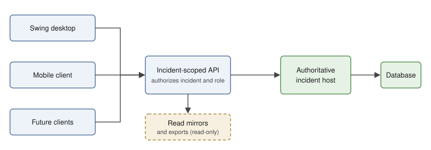

# Draft Work Plan

## Big picture

### What the system is for

`icsforms-client` supports the command post of an incident run under the
Incident Command System. It lets people in the incident management team produce
and keep current the documents an incident runs on — ICS 201–208, 214,
215/215A, medical and communications plans and T-cards, including SAR-specific
extensions for task assignments and debriefs, and a clue log — and print them
individually or as a combined Incident Action Plan. Incidents range in scale and
infrastructure, including rural, intermittent-connectivity events staffed by
volunteers who arrive at different times, work shifts, share laptops, and carry
their own phones.

### Where it is today

A single-user Java Swing desktop application: one operator, one laptop, one
incident at a time, saved as local JSON files with revision checks and backups.
The core SAR form set is complete, as are focused role panels (Safety, Medical
Unit Leader, Operations, Incident Command, Communications) and separate human and
canine medical reference windows. The persistence foundation is merged: saves use
detached snapshots on a background coordinator behind backend-neutral revision
and failure seams. Work to make open views refresh without flicker or stale
content is in review (PR #56). This is standalone operation, not yet a local-host
deployment. Details of delivered work are in
[`docs/completed-work.md`](docs/completed-work.md).

### Where it is going

The same application, unchanged for the solo user, grows into a system that can
run in four topologies without ever removing the earlier ones:

| Topology | Description | Stage |
| --- | --- | --- |
| **T0 Standalone** | One laptop, local files (today). | Today |
| **T1 Local host** | Several workstations on incident Wi-Fi; one of them hosts the incident service and store. | Stage 2 |
| **T2 Networked store** | A field or site server; single-user phones and multi-user shared workstations as clients. | Stages 3–4 |
| **T3 Hosted** | Cloud service, remote access, read-only mirrors, planned authority transfer with the field. | Stages 5–7 |

Four ideas are central to the design:

1. **One authority per incident.** A single host owns the record at any moment.
   Clients keep a working copy and an outbox; they never write to a database
   directly and never act as independent masters.
2. **A device trust boundary, not a shared password.** A device is admitted once,
   in person, by redeeming an administrator-issued, short-lived invitation
   (QR/short code) for an individually revocable device credential. Switching
   operators at a shared workstation is then a frictionless, attributed *claim*
   from the ICS 211 roster, not a login. Outsiders on the same Wi-Fi get nothing;
   responders join in under a minute; lost devices are revoked individually.
3. **Stable identity and provenance everywhere.** Every record has a durable
   UUID; every append-style entry records who entered it, from which station,
   and when (UTC), with room for when the host accepted it. This is what makes
   per-record concurrency, sync and audit possible later without a rewrite.
4. **Current information, visibly current.** Every open view of an incident
   reflects the latest accepted state available to that device, without manual
   reload. A committed change from any workspace, window or connected station
   updates every affected display promptly and consistently: forms, role
   panels, contact and channel lookups, summaries, status badges and previews.
   Views must not silently show superseded information. Unsaved edits are
   preserved and conflicts with newer data are made explicit rather than
   overwritten. Each view updates only the content affected by a change,
   without avoidable rebuilding or visible flicker. When a device is offline,
   disconnected, waiting for synchronization or cannot refresh a projection, it
   clearly labels the information as possibly stale and states when it was last
   confirmed as current.

### How we get there

1. **Done: standalone preparation (T0).** Role panels (issues #33, #46, #49)
   and Stage 1, the persistence foundation (issues #37, #39–#44) together with
   the live-refresh work that removed avoidable rebuilds and flicker (PR #56,
   the standalone part of idea 4), are complete.
2. **Next: decide, then build T1 (Stages 0 and 2).** Record the Stage 0
   decisions and resolve the remaining Stage 1 exit-evidence question. Stage 2
   then adds the incident API, a `RemoteIncidentStore` and the first local host
   with simple device admission, so two workstations can share an incident on
   incident Wi-Fi.
3. **Then: shared and offline use (T2, Stages 3–4).** Stage 3 adds the full
   invitation lifecycle, operator claim, roles, per-record concurrency and
   audit. Stage 4 adds the durable outbox, offline sync, conflict workflows and
   attachments, so devices keep working when disconnected.
4. **Finally: field packaging and hosting (T3, Stages 5–7).** Stage 5
   packages a field host that runs without internet, with backup, restore and
   planned authority transfer. Stage 6 adds a hosted deployment with read-only
   mirrors. Stage 7 adds a mobile client and operational hardening.
5. **Throughout: idea 4.** Visible staleness, explicit conflicts and
   no-flicker refresh extend through every stage (see "Current information and
   freshness" in Part III).

Every stage ends with a usable, recoverable standalone application. Nothing in
the later stages may make the solo-laptop case harder.

### How to read this document

**Status date:** 2026-11-08. Status entries are based on the committed source
tree, named regression tests and CI results, not on issue or PR closure alone.

- **Part I — Delivered work:** summary only; the detailed record is in
  [`docs/completed-work.md`](docs/completed-work.md).
- **Part II — Design contracts:** binding invariants for role-panel and
  persistence work.
- **Part III — Architecture and topologies:** target architecture, device trust
  boundary, freshness requirements and engineering requirements.
- **Part IV — Staged work plan:** gates, dependencies, exit criteria and sizes.

## Part I — Delivered work (summary)

| Area | Tracking | State |
| --- | --- | --- |
| Core SAR forms (ICS 203, 205, 206 and canine 206, 215/215A, 208, 233-CG clue log), ICS 215, SAR task ↔ ICS 214 integration, ICS 204 layout | #13–#20, #35 | Complete |
| File-backed `IncidentStore` with UUID identity, revision checks, edit-lock capability and backups | PR #34, #39–#42 | Complete for standalone use |
| Live local role panels (ten phases): live multi-view, objectives and linkage, review tracking, medical references, Safety/MUL, Operations, Incident Command, Communications and console | #33, #46, #49 | Implementation delivered; automated coverage recorded. Manual assistive-technology review is not recorded (optional). |
| Stage 1 persistence foundation: deterministic Swing tests, store contract suite, backend-neutral semantics, strict imports and identity migration, UTC time, provenance seam, asynchronous snapshot persistence, and live refresh without flicker | #37, #39–#44, PR #56 | Complete; exit-evidence question open (Stage 1) |

Role-panel work is independent of the persistence roadmap and must not
introduce network, authentication or remote persistence features.

---

## Part II — Design contracts (binding)

These contracts were agreed for issue #33 and remain binding for all role-panel
and persistence work. They are invariants, not a status report. Phase-by-phase
delivery evidence is in [`docs/completed-work.md`](docs/completed-work.md).

### Ownership and behavioral contracts

- Incident facts, objectives, relationships and review assertions belong in the
  shared persisted model. Panels own only selection, filters, split positions,
  focus, draft input and preview presentation.
- A role panel is a view preference, separate from Current user position and not
  authorization. All comprehensive editors remain reachable through existing
  typed destinations, including nested medical destinations and individual
  activity-log instances. Remove superseded role-driven tab reordering only
  once discoverable panel entry points and stable full-workspace navigation work.
- All windows show one explicit incident/operational period. Validate before
  committing; rejected table input stays editable and blocks its operation.
  Do not refresh away partial text, flush unchanged stale fields, or allow
  delayed callbacks to apply to another incident/period.
- Planning and deployment are concurrent. Missing or unreviewed plans do not
  gate assignment creation or task status changes. A simple medical plan is
  legitimate; missing fields are not a sufficiency judgment.
- Review is a person's explicit assertion about current content at a time,
  not authenticated approval or an electronic signature. Preserve printed
  signature fields and semantics independently.
- Opening a reference or preview has no incident effects: no log creation,
  response declaration, task change or automatic event. No network sync is added.

### Objective, assignment and review contracts

Objectives have stable IDs, text and order, plus explicit **Not assessed /
Ongoing / Achieved / No longer applicable** assessment, note and update metadata.
Migrate legacy strings additively without guessed links. Assignments support
zero/multiple objective IDs, normally one; objectives support multiple assignments.
Keep one authoritative relationship shared by ICS 204 and the linked SAR task.
Reordering and text edits preserve links. Removing a linked objective requires
explicit unlink/reassignment resolution. Creating supporting work creates a
normal immediately editable assignment prelinked to that objective, never a
proposed/request/approval object.

Preserve period-end wording, relationships and assessments in independent deep
copies. Objective carry-forward is optional; if implemented, create new-period
identity with predecessor provenance and reset assessment. Do not carry
assignments automatically. Deduplicate resource totals by stable identity:
multiple objective links do not create separate allocations. Task completion and
debrief never calculate or change objective assessment. Assessment metadata does
not enter standard ICS PDFs.

Persist the reviewed content/revision boundary for safety, human medical, canine
medical and communications. Display **Not yet reviewed / Reviewed-approved by
person at time / Changed since review**, retaining earlier assertion metadata.
Meaningful plan/shared-value changes invalidate review; navigation, generated
page numbers, preview work and review metadata do not. Explicit re-review
acknowledges current content. New periods need fresh review. There is no mandatory
Draft/submission workflow; readiness is optional and must not impede small
incidents.

### Layouts and workflow contracts

**Two medical references, never a combined window**

Separate launch actions and nonmodal windows:
**Human Medical Reference — ICS 206** and
**Canine Medical Reference — adapted ICS 206CANINE**.
Both may remain open; neither has a type toggle.

Each contains incident/period/review header; instructions and personnel,
aid-station and transportation column; facility list with selected details;
optional task context; complete standard PDF preview; explicit log/editor
actions. Show latest working content even incomplete. Instructions, transportation,
facilities, previews and logging defaults never cross types or silently fall back.
Shared transport appears only when explicitly recorded for that plan.

Sort by current recorded road distance where available without hiding unrouted
facilities. Show origin, distance/duration provenance and age, stale/unknown/
unrouted state, contacts, availability, capabilities and verification. Distinguish
accepted plan snapshots from directory candidates. The operator chooses; there
is no suitability algorithm or new human routing service.

Link zero/multiple veterinary personnel T-cards, retaining free text and missing
link information. Display recorded assignment, status and location without
implying availability or an aid-station posting. Task context includes assignment/
team, members/resources and communications, never determines reference type.
Only explicit confirmed **Log medical event…** creates a log entry, using
**Responder medical event** or **Response canine medical event** in the existing
mechanism. No automatic duplicates across people's logs or unnecessary clinical
detail.

**Safety Officer and Medical Unit Leader**

Responsible-item worklist left, selected detail and on-demand PDF right; optional
Show all is not an access control. Safety covers safety planning, reported hazards
and medical review. MUL covers human/canine development, personnel, aid stations,
transport, facilities and review handoff. Provide focused shared edits and
re-review inline, plus full-editor links for extensive changes.

**Operations**

Incident/period header with New assignment and separate Human/Canine reference
actions. Task board left, selected task detail/actions right, resources below.
Actions: see statuses, change status, add log entry, **Record clue**, create
assignment, **Debrief task**, select recorded available resources for new work.
Reuse existing lifecycle/clue/log/debrief operations and status vocabulary.
Show members, objectives, hazards, resolved communications/legacy fallback,
reported results and debrief. Preserve task/resource selection on live updates.
Recorded location/availability is not inferred actual location/readiness.

**Incident Command**

Header: Add objective / Open ICS 202 / Full workspace. Left: ordered objectives
(number/text/assessment); focused full-text/assessment/note editor; supporting
assignments (status/resources/result/debrief); Link existing / Create supporting /
Open assignment / Open debrief; reported results with sources.

Right: Safety/Human/Canine/Comms plan status; deduplicated resource totals; Open
Operations. The Objectives badge reports objectives without linked assignments
and assignments without a current objective link; the objective table highlights
the missing-link cell. There is no separate observational-attention panel or
formal command-request queue. Not every objective needs field work, and planned
assignments without resources differ from no planned assignment.

**Communications**

First-class responsible-item worklist, review state, channel overview and PDF,
unresolved links, linked tasks/resources, focused shared edits and full
editor/import access. Use immutable `ChannelLinkSource` snapshots: unique explicit
resolved IDs take precedence; absent/missing/ambiguous links retain legacy text
and visible unresolved state. Channel assignment is not a radio check.

### Exclusions and scope boundary

No permissions/authentication/e-signatures, automatic events, clinical support,
suitable-facility choice, computed achievement, formal resource requirements/
request/approval/ordering queue, structured meeting workflow, mobile application,
remote persistence/sync/concurrency, combined-role widget builder, cross-period
panel, simultaneous next-period planning, or blanket legacy-frequency replacement.
Do not reinterpret assignments as resource requests. Role-panel work does not
depend on, and must not pre-empt, the persistence roadmap in Part IV.

---

## Part III — Target architecture and deployment topologies

### Deployment topologies

The system must grow through four topologies without ever removing the previous
one. Each later topology is opt-in; no account or server is required to open and
edit a local incident.

| Topology | Description | Persistence | Identity and trust |
| --- | --- | --- | --- |
| **T0 Standalone** | One device, one operator, no network. Today's application. | `FileIncidentStore` (local JSON) | Operating-system user; injectable operator context defaults to blank (#44). |
| **T1 Local host** | Several workstations on incident Wi-Fi; one of them runs the authoritative incident service (embedded in the desktop application or as a small local process) and houses the store. No internet required. | Host: file or embedded database. Clients: `RemoteIncidentStore` over an incident-scoped API, with a durable local cache/outbox. | Device admission by invitation (QR/short code) issued by an incident administrator; device-bound revocable credential; operator claim per workstation. |
| **T2 Networked store, mixed clients** | A networked persistence service (field host or site server) with multiple client devices: single-user phones/tablets and multi-user shared workstations. | Same API as T1; service may be backed by a database. | Same device trust boundary as T1. Shared workstations distinguish *device admission* (once) from *operator claim* (per shift). |
| **T3 Hosted** | Cloud-hosted authoritative service with remote access and read-only mirrors; planned authority transfer between field and hosted. | Managed database; encrypted export/import for transfer. | Same boundary plus durable administrator accounts and TLS host identity. |

The table describes the eventual topologies, not features already delivered.
Stage 1 (Part IV) prepares T0 for T1 without implementing any network code.
Stage 2 delivers the initial T1 host and basic device admission. Stage 3 expands
the trust boundary and adds operator claim; Stage 4 adds the durable outbox and
offline sync. Later stages add field-host packaging, T3 and the mobile client.

### Device trust boundary and low-friction joining

The requirements "new responders join with minimal friction", "people share
workstations with minimal friction" and "outsiders cannot connect or see
incident data" conflict only if one credential has to serve all three. The
resolution is two layers:

**Layer 1 — Device admission (the trust boundary; once per device).**
A device is admitted only by redeeming a short-lived join invitation issued by an
incident administrator: a QR code or short code scoped to one incident, a role
ceiling, an expiry and a use limit, embedding the host address and the host's
certificate fingerprint so the client pins the host. The device generates a key
pair and receives an individually revocable, device-bound credential. The API
accepts nothing without such a credential, so being on the incident Wi-Fi grants
nothing. Physical possession of the invitation at check-in *is* the vetting step
and piggybacks on ICS 211 check-in rather than adding a new process.

**Layer 2 — Operator claim (low friction; many times per shift).**
On an admitted workstation, changing operators is a *claim*, not a login: the
operator is selected from the ICS 211 roster / personnel T-cards, optionally with
a short self-set PIN. The device credential still authorizes every request; the
operator claim is attribution recorded in provenance (#44) and audit history.
Effective role is the lesser of the device's role ceiling and the operator's
assigned position. Only checked-in people can be claimed.

Controls this yields: expired/used invitations defeat photographed QR codes;
host-certificate pinning defeats evil-twin hotspots; lost devices are revoked
individually; demobilised devices expire at period close or demobilisation; a
bystander at an unlocked workstation can at most mis-attribute, mitigated by
screen-lock timeout and the physically controlled ICP. **Never use a shared
incident password**: it is low friction on day one and unrevocable on day two.

Roles (minimal set): `observer` (read), `field` (own task's ICS 214, debrief,
clue reports — the phone default), `section` (edit assigned forms), `planner`
(all forms, period rollover), `admin` (invitations, roster, revocation, authority
transfer). Enforced server-side; clients only hide what they cannot do.

### Target architecture



- **No direct database access from any client.** Database credentials, migrations, authorization, and validation remain on the host. A client receives only the data and operations permitted for its incident and role.
- **Incident-scoped API.** Each request is authorized against an incident and a responder's role. Incident boundaries are enforced in the service layer, not left to client-side filtering.
- **Offline-first clients.** Clients keep a local working copy and queue edits while disconnected. Connectivity is an optimization, not a prerequisite for recording field work.
- **One authority per incident.** A field computer or cloud service is the single authoritative host at a time. Remote mirrors can serve permitted reads and backups, but are not independent writable masters.
- **Preserve standalone mode.** Existing local-only use remains supported and usable. Shared-host features should be opt-in; no account or server should be required to open and edit a local incident.
- **Keep a clean contract boundary.** Use a versioned JSON API and explicit transfer objects rather than exposing database entities. HTTP request/response operations are sufficient initially; add a live-update channel only when polling or change feeds no longer meet operational needs.
- **Avoid premature technology commitments.** Select the database, host packaging, and identity mechanism in Stage 0 based on offline operation, maintainability by a small team, recovery, and upgrade constraints. PostgreSQL is a reasonable hosted candidate, but a field host must be supportable without internet and without exposing database ports to the incident LAN.

### Authority, ownership, and transfer

Each incident has one authoritative host at any moment. This avoids split-brain edits when a field deployment loses internet connectivity or a cloud link fails. Devices may create offline edits, but those edits are pending client changes until accepted by the current authority.

Moving an incident between field and hosted modes is a planned operation, not automatic multi-master replication:

1. The outgoing host stops accepting edits or enters a clearly marked transfer/freeze state.
2. Connected clients sync; outstanding offline edits are identified and retained for resolution.
3. The host creates a complete, integrity-checked incident export, including attachments and schema version.
4. The receiving host imports and validates the incident and confirms the new authoritative identity.
5. Clients are directed to the new authority; the old host becomes read-only or is securely retired.

Remote mirrors should be explicitly described as read-only, and show their last successful synchronization time. Define how stale data is presented so no responder mistakes a mirror for the current authoritative record.

### Current information and freshness

Idea 4 turns into these requirements, which later stages must meet as the
system gains more than one view or station:

- **One source of truth per device.** Every view is derived from one committed
  model; no view keeps its own copy of shared facts. A commit publishes one
  change notification, and each affected view updates from it.
- **Update only what changed.** A view compares its displayed inputs with the
  new model and skips work when they are unchanged. Refreshing must not rebuild
  components, reset selection, scroll, focus or in-progress text, clear previews
  or disable windows. Unchanged navigation commits nothing.
- **Unsaved edits win until resolved.** A refresh never overwrites a draft. When
  newer data conflicts with a draft the conflict is shown and the operator
  resolves it; prior values are retained.
- **Staleness is visible.** A view that is offline, waiting for sync, showing a
  read-only mirror, or unable to refresh a projection (for example a PDF
  preview or a routing result) says so and shows when it was last confirmed
  current. Absence of a warning must mean the information is current.
- **Freshness of data, not only of screens.** Recorded facts that age (for
  example facility availability, routing results, review assertions) show their
  source and age. Corrections flow to the owning record rather than to copies.
- **Measured.** Refresh behaviour is covered by regression tests that count
  rebuilds, notifications and window state with representative data (for
  example `docs/examples/maple-ridge-dementia-op1.json`).

### Engineering challenges and design requirements

#### Concurrent editing and auditability

Several responders may edit separate assignments or forms at once. Avoid whole-incident locks. Give independently editable records stable identifiers and versions, and use optimistic concurrency so stale updates are detected instead of silently overwriting newer work. Prefer append-oriented records for activity logs, clues, and similar events. Keep an audit history of changes, including the attributed responder, device, time, and operation.

For genuine conflicts in narrative fields, start with a visible conflict-resolution workflow and retained prior values. Do not introduce complex text-merging algorithms until field experience demonstrates a need. Conflict handling must be usable on a small screen and understandable under incident pressure.

Cross-form values are shared facts, not separate copies. Define which form or entity owns each value (for example, resource identity, operational period, assignment, and personnel) and derive other views and PDFs from it. Record the source and time for derived values, and make corrections flow back to the authoritative source rather than creating inconsistent duplicates.

#### Offline synchronization

Clients need a durable local cache and outbox. Queue idempotent, uniquely identified operations so retrying after a lost connection does not duplicate an assignment, clue, or log entry. Synchronize with an ordered host change cursor rather than trusting device wall clocks. Preserve local timestamps for display and audit, but do not use them as the sole ordering mechanism.

Specify behavior for stale clients, deleted or struck-out records, schema changes, and edits made while an operational period is closed. Do not silently discard queued work. Show pending, accepted, rejected, and conflicting changes clearly, with a way to recover/export unsynced work.

#### Attachments, performance, and reliability

Photos, maps, and sketches can be large and are important in SAR. Store attachment metadata separately from form records; transfer metadata first and upload/download bytes on demand when possible. Use content hashes to detect corruption and avoid duplicate transfers. Exports and backups must include attachment bytes or clearly report missing items.

Expect constrained devices, slow local Wi-Fi, intermittent internet, and incidents with large resource lists or many log entries. Paginate or filter large collections, avoid repeatedly transferring entire incidents, and measure sync and PDF-generation performance with realistic fixtures. Make autosave and queued edits durable across app crashes, battery loss, and host restarts.

#### Access control for responders without existing accounts

The device trust boundary above is the governing design. Required behaviours:
administrators issue scoped invitations (one incident, role ceiling, expiry, use
limit) as a QR or short code carrying the host address and certificate
fingerprint; the responder names themself or claims an ICS 211 roster entry
(self-asserted unless independently verified); the device creates a key pair and
redeems the invitation for a revocable, device-bound credential; the host
enforces role permissions, records device and operator, and expires or revokes
access at demobilisation, incident close or administrator action. Provide a
roster of active devices with expiry and last-seen status, lost-device
revocation, rate limits and invitation revocation. Never treat a shared incident
password or invitation code as a long-lived credential, and never let a redeemed
token grant database access.

#### Offline transports and data security

Use incident Wi-Fi as the primary local transport. Bluetooth may be evaluated as a secondary option for pairing or deliberate transfer, but it must not become an unencrypted API channel. If no network is available, support deliberate exchange of encrypted, authenticated incident bundles on removable media where operationally appropriate. Do not send incident data in cleartext over radio.

Protect transport and stored credentials, verify the host identity (especially on an ad hoc field network), and minimize sensitive data in logs and notifications. Establish encryption, key recovery, lost-device handling, retention, and secure deletion requirements before deployments contain real incident or personal information. Document what remains available if a device or host is lost.

#### Schema and API change management

Version local documents and API contracts. Use forward migrations that are never edited after release, test upgrades from supported prior versions, and keep backups before migration. Prefer additive/expand-and-contract changes so older clients can continue operating during a gradual rollout. The server must identify incompatible clients clearly rather than accept edits it cannot interpret.

Maintain representative fixture incidents for every supported format and verify load/save round trips, migration, exports, attachments, and unknown-field handling. Test both migration from an empty store and upgrades from released fixtures. Keep form-specific payloads flexible where requirements are still evolving, but model shared identities, incident/operational-period boundaries, and security-relevant fields explicitly.

#### Operational and product concerns

- **Recovery and continuity:** document host backup schedules, restore drills, disk-full behavior, power-loss recovery, and recovery time expectations. A backup that has not been restored in a test is not a proven recovery plan.
- **Deployment and updates:** make field-host installation, upgrade, rollback, and health status understandable to a small team. Plan for delayed client upgrades and avoid requiring internet for local operations.
- **Privacy and records:** classify personal and sensitive incident data, set retention and export policy, control logs, and make audit history tamper-evident enough for operational review. Establish who owns the official record and how an incident is archived.
- **Time and provenance:** preserve unambiguous timestamps and the incident's display time zone; record when data was entered, by which device, and when the host accepted it. Treat device clocks as potentially wrong.
- **Accessibility and usability:** join, sync, conflict, and revocation flows must be usable during stressful operations, with clear status and minimal typing. Avoid hiding authority, stale-data, or pending-sync state.
- **Testing and support:** test API contract compatibility, offline/reconnect paths, simultaneous edits, transfer and recovery, and security boundaries. Provide diagnostics that aid support without leaking incident contents or credentials.

### Repository organization

Keep the work in one repository while the team and product are small. Atomic changes to the model, API, Swing client, server, and tests are more valuable initially than independently versioned repositories. Organize boundaries so a later split remains possible:

```text
icsforms-client/
  model/ or icsforms-model/       shared incident domain and validation
  api/ or icsforms-api/           versioned API contract and DTOs
  client-core/                    persistence, offline outbox, sync, HTTP client
  swing/                          current desktop UI and standalone packaging
  server/                         authorization, incident API, host deployment
  testkit/                        versioned fixtures and contract/transfer tests
  mobile/                         mobile client if its toolchain fits the repository
```

These are logical boundaries first; introduce Maven modules only when they reduce coupling rather than create ceremony. Keep PDF rendering dependent on the shared model, not Swing. A separate mobile repository is reasonable if its platform toolchain or release process makes a shared build impractical; publish and test against the API contract rather than copying DTO definitions. Split repositories only when ownership, release cadence, or tooling makes the single-repository approach a demonstrated obstacle.

## Part IV — Staged work plan

Estimates are rough person-weeks for a small experienced team, excluding review,
field trials and delays; refine after each stage. Each stage leaves a usable,
recoverable standalone application. Completed stages are recorded in
[`docs/completed-work.md`](docs/completed-work.md).

| Stage | Delivers | State | Size |
| --- | --- | --- | --- |
| 0 | Written decisions and constraints | Not evidenced as complete | 1–2 weeks |
| 1 | Local persistence foundation, including live refresh without flicker | Complete; exit-evidence question open | done (4–7 weeks) |
| 2 | Incident API and local host (T1) | Not started | 4–8 weeks |
| 3 | Multi-user editing, operator claim, roles, audit (T2) | Not started | 4–7 weeks |
| 4 | Offline sync and attachments | Not started | 5–9 weeks |
| 5 | Field-host packaging and authority transfer | Not started | 4–8 weeks |
| 6 | Hosted deployment and remote mirrors (T3) | Not started | 4–8 weeks |
| 7 | Mobile client and hardening | Not started | 6–12 weeks |

### Stage 0 — Decisions and operational constraints

Agree, in writing, on incident authority and transfer, data classification and
retention, offline conflict semantics, how staleness and conflicts are presented
(idea 4), supported device/network assumptions, join-invitation roles and
recovery, host operations, and minimum supported client versions. Choose the first deployment target (T1 is recommended) and technology
only after those constraints are explicit. This stage may run in parallel with
Stage 1; it must finish before Stage 2 begins.

**Exit criteria:** written decisions, threat and recovery assumptions, first
API/domain boundary, success measures, and a deliberately limited T1 pilot plan.
**Status:** not yet evidenced as complete in the repository. The topology and
design contracts below describe targets, not a record that all required decisions,
threat/recovery assumptions, API boundaries, success measures and pilot scope have
been agreed. Record those decisions before starting Stage 2 implementation.
**Rough size:** 1–2 person-weeks.

### Stage 1 — Local persistence foundation (complete)

All gates (deterministic Swing tests, store contract suite, backend-neutral
semantics, strict import and identity migration, UTC time, provenance seam,
asynchronous snapshot persistence) are closed and merged, with no network code,
authentication or server. Gate details, the entity-ID audit and CI evidence are
in [`docs/completed-work.md`](docs/completed-work.md).

Live refresh was an unanticipated part of this stage (PR #56). Open views now
update only what changed and no longer flicker: no-op flushes commit nothing,
the tab strip is reconciled in place, role panels skip unchanged rebuilds,
organizational chart identities and recorded review statuses are stable, and
plan-reuse checks no longer pause incident windows. The behaviour was checked
by hand against the Maple Ridge example for tab switches and ICS 214 log-entry
adds with role panels open. This is the standalone part of idea 4; the
requirements that extend it to multiple stations are in Part III.

**Open exit question:** the stage criteria asked for a `RemoteIncidentStore`
stub passing the contract suite in an unmerged spike branch. The merged
test-only, lockless `RemoteIncidentStore` double passes the shared contract and
is exercised through `AppController`, which is substantial but not literal
evidence, and no network-backed store has been demonstrated. Either complete the
spike or explicitly accept the merged double as equivalent evidence.

**T0/T1 readiness:** Stage 2 is not yet a cleared start: record the Stage 0
decisions and resolve the question above. Neither requires an API,
authentication or outbox in Stage 1.

### Stage 2 — Incident API and single local host (delivers T1)

Implement the incident-scoped API, host-side validation and persistence, and a
`RemoteIncidentStore` built on the Stage 1 contract. The first host is the
desktop application itself (or a small co-installed process) serving other
workstations on incident Wi-Fi with no internet. Add explicit host identity
(self-signed certificate with fingerprint shown for QR embedding) and health
status. Device admission by invitation is included here in its simplest form so
that the API is never reachable without a credential, even in a pilot.

**Exit criteria:** two admitted workstations read and update one incident through
the API; a non-admitted device on the same network is refused; one incident cannot
access another; the standalone path is unchanged; the Stage 1 contract suite passes
against the remote store.
A client shows when it cannot reach the host and labels what it shows as
possibly stale, with the time it was last confirmed; remote changes refresh
open views without flicker or loss of drafts.
**Rough size:** 4–8 person-weeks.

### Stage 3 — Multi-user editing, operator claim, roles and audit (delivers T2)

Add full invitation lifecycle (issue, expiry, use limit, revocation), device roster,
operator claim from the ICS 211 roster with optional PIN, role-based permissions,
per-record optimistic concurrency, host-populated `acceptedAt`, and audit history
keyed by device and operator. Build clear conflict and stale-update UX. Keep the
first role set to the five roles in Part III.

Stage 1 establishes the provenance fields and controller seam only. The production
standalone startup currently uses the empty default `OperatorContext`; it does not
wire a locally entered name to that context. Injected nonempty contexts are covered
by tests. The Stage 3 claim is intended to populate operator and station attribution
for new records; only the authoritative host sets `acceptedAt`. Existing records
without provenance remain unattributed.

**Exit criteria:** a responder joins with a scoped invitation in under a minute;
shared-workstation operator switch is one action; administrators see and revoke
devices; simultaneous edits do not silently overwrite; every change is attributable.
A newer remote change to a record being edited is surfaced explicitly, with
the operator's draft preserved.
**Rough size:** 4–7 person-weeks.

### Stage 4 — Offline sync and attachment handling

Durable local outbox of idempotent operations, ordered host change cursor,
reconnect and conflict workflows, attachment transfer, and closed-operational-
period behaviour. Unsynced work survives client restarts and can be exported.

**Exit criteria:** airplane-mode edits sync correctly after reconnect; replay does
not duplicate work; conflicts and rejected edits are visible and recoverable;
attachments transfer reliably on constrained links.
Pending, accepted and rejected changes are labelled per view, and the last
successful sync time is always visible.
**Rough size:** 5–9 person-weeks.

### Stage 5 — Field-host packaging and authority transfer

Package and document a field host that runs without internet: installation,
upgrade, rollback, backup/restore, encrypted incident export/import, and planned
authority transfer between hosts. Evaluate Bluetooth or removable-media workflows
only against tested security and operational requirements.

**Exit criteria:** a field exercise starts, operates, backs up, transfers and
restores an incident without internet; no database service is exposed to clients;
host loss and recovery are rehearsed.
**Rough size:** 4–8 person-weeks.

### Stage 6 — Hosted deployment and remote mirrors (delivers T3)

Deploy the same service in a managed cloud environment. Add durable administrator
accounts, secure remote access, monitoring, backups, tested restore, and clearly
read-only mirrors with visible staleness. Define the process for moving authority
between field and hosted deployments.

**Exit criteria:** remote users access only permitted incidents and functions;
restores and transfer are tested; mirror staleness and authority are visible.
A mirror never presents data as current beyond its last confirmed sync time.
**Rough size:** 4–8 person-weeks.

### Stage 7 — Mobile client and operational hardening

Build or integrate a mobile client against the versioned API with offline-first
capture, rapid invitation joining, `field` role by default, attachment workflows
and clear sync status. Conduct field usability, performance, security and
supportability testing before broad deployment.

**Exit criteria:** mobile and desktop clients pass API compatibility,
offline/reconnect, access-control and transfer tests; representative users
complete a field exercise; release, support and incident-record procedures are
documented.
**Rough size:** 6–12 person-weeks.

### Time and provenance roadmap

| Step | Where | What |
| --- | --- | --- |
| 1 | Stage 1 (#37, done) | UTC generation and storage; zone-aware display and print. |
| 2 | Stage 1 (#44, done) | `Provenance` on append-style records; injected `OperatorContext` seam; `acceptedAt` reserved and unused locally. |
| 3 | Stage 2 | Host records receive time; device clocks treated as untrusted for ordering. |
| 4 | Stage 3 | Host populates `acceptedAt`; operator claim fills `operatorName`/`stationId`; audit history keyed by device and operator. |
| 5 | Stage 4 | Ordered host change cursor replaces wall-clock ordering for sync; local timestamps retained for display and audit. |

## Working rules

- Keep pull requests small, focused, and reviewable; land schema/API changes with their migration and tests.
- Preserve a usable standalone application and deliver a usable, recoverable state after each stage.
- Prefer a tested simple mechanism over speculative infrastructure; avoid distributed consensus, peer-to-peer master writes, and sophisticated merge algorithms until a demonstrated need justifies them.
- Treat offline, stale data, host loss, and responder turnover as normal operating conditions, not exceptional cases.
- Make authority, sync status, role, and data freshness visible to users.
- Test with fixture incidents and realistic field constraints; do not use real sensitive incident data in public test fixtures.
- Revisit estimates and assumptions after each stage and field exercise. Defer work that is not necessary to prove the current stage's exit criteria.
